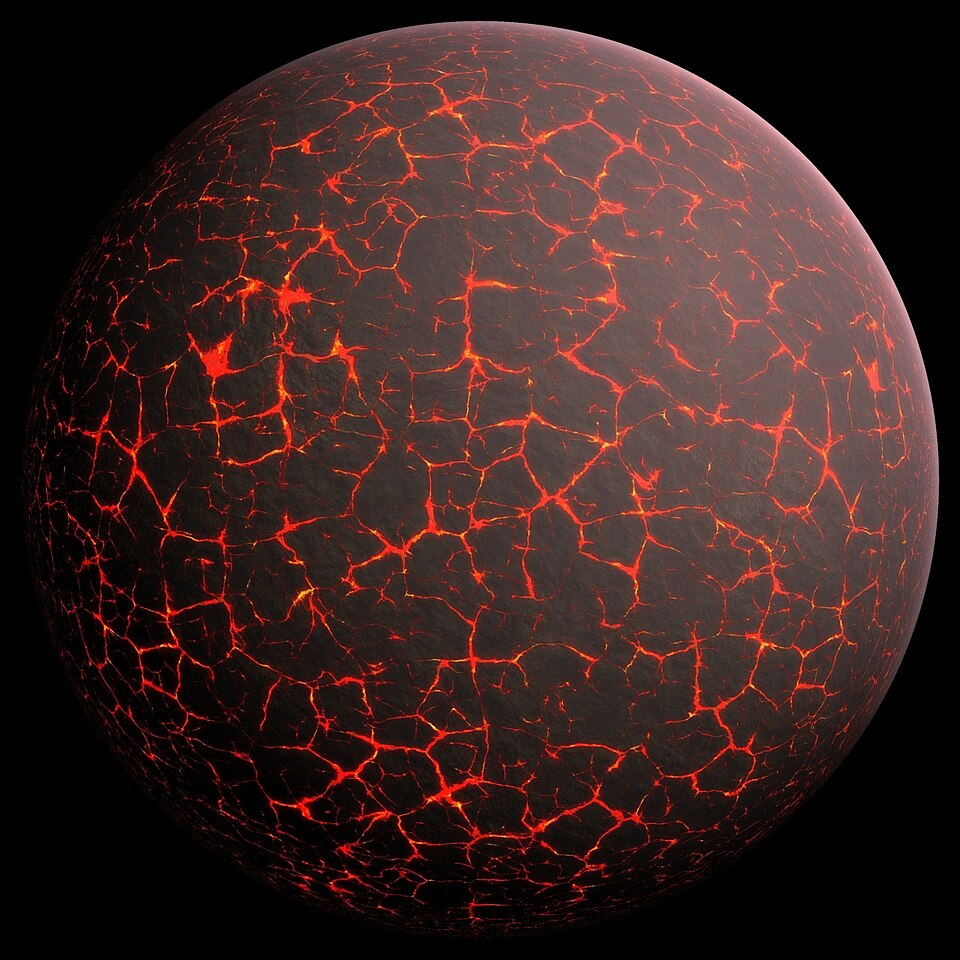
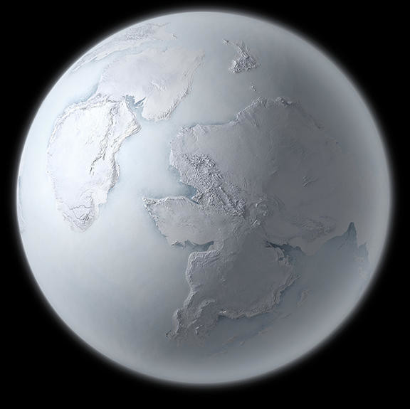
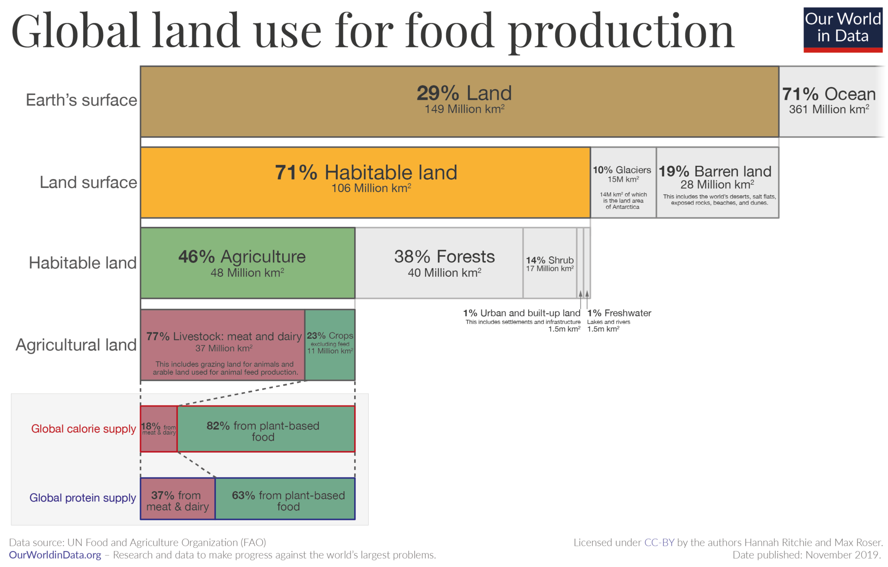

At the moment, the atmosphere has enough carbon dioxide that even if humans stopped all CO2 emissions, it will still keep rising due to a number of [chain reactions](https://en.wikipedia.org/wiki/Tipping_points_in_the_climate_system). The big question then is how do we remove the excess?

To find an answer, perhaps we can look at the big history of earth over its roughly 4.5 billion year history. It has had the same amount of carbon for the past 4 billion years. Immediately after the planet was formed from the solar furnace, it was hot.

  </img>
  <figcaption><a href="https://en.wikipedia.org/wiki/History_of_Earth#/media/File:Earth_formation.jpg">Artist's depiction</a> of Earth during the first few hundred million years after its formation</figcaption>

However, once that heat had radiated into space, the entire (almost) temperature history of Earth can be explained in terms of the variation in greenhouse gases in the atmosphere! From basic chemistry, one knows that oxygen is a highly reactive gas compared to nitrogen -- and carbon dioxide and methane. In other words, it is a miracle for a planet's atmosphere to be rich in oxygen at all! In the presence of vastly greater amounts of carbon dioxide (and methane) -

> Temperature reconstructions based on oxygen and silicon isotopes from rock samples have predicted much hotter Precambrian sea temperatures. These predictions suggest ocean temperatures of 55–85 °C during the period of 2,000 to 3,500 million years ago [...]
>
> \- _source: [Geologic Temperature Record - Wikipedia](https://en.wikipedia.org/wiki/Geologic_temperature_record)_

So, how was carbon dioxide converted to oxygen? And that too [so much of it](https://en.wikipedia.org/wiki/Great_Oxidation_Event) that at one point, earth was plunged into an ice age lasting hundreds of millions of years!

  </img>
  <figcaption>Earth during great glaciation (<a href="https://news.cnrs.fr/articles/when-earth-was-a-snowball">source</a>)</figcaption>

The answer: ~~Life.~~ Photosynthesis.

Happening over a span of not 100 year (human life), not 1000 years (medieval periods), not 10000 years (agriculture), not 100,000 (homo sapien), not even a million (homo erectus), not 10 million, not 100 million (dinosaurs), but over two billion years(!). Two billion years of pure photosynthesis.

That basically suggests the possibility to remove the excess carbon dioxide we have emitted in our measly modern civilization of 400 years.

However, there is a trouble. Even when certain organisms store carbon dioxide (and methane) in their bodies, this stored carbon dioxide gets emitted once the organism dies. How then did the [great oxidation events](https://en.wikipedia.org/wiki/Great_Oxidation_Event) proceed? Of which, there have been not one, but at least [two](https://en.wikipedia.org/wiki/Neoproterozoic_oxygenation_event). The answer is that **the organism's body was buried without decomposition.**

Annually, [about 0.1 to 0.01 GT of carbon sinks into the earth's crust](https://science.nasa.gov/earth/earth-observatory/the-carbon-cycle/). By contrast, as of 2024, the [total CO2-equivalent emissions are in the ballpark of 14GT C (= 53.2 GT CO2)](https://edgar.jrc.ec.europa.eu/report_2025). Thus, even though the two differ by an order of magnitude, they suggest a potential way to move to Net Negative.

[This actually got suggested recently.](https://www.technologyreview.com/2022/12/15/1065016/a-stealth-effort-to-bury-wood-for-carbon-removal-has-just-raised-millions/). The idea is to bury dead trees underground without letting them decompose. As extravagant as it sounds, it rests on the simple principle that

> Slow or deep carbon cycling is an important process, [...] If the process did not exist, carbon would remain in the atmosphere, where it would accumulate to extremely high levels over long periods of time. Therefore, by allowing carbon to return to the Earth, the deep carbon cycle plays a critical role in maintaining the terrestrial conditions necessary for life to exist. ([source](https://en.wikipedia.org/wiki/Carbon_cycle))

There are two other problems: One, [forests do not absorb carbon forever](https://phys.org/news/2013-08-europe-forests-carbon-saturation.html). They only absorb carbon while they are still growing and [once they stop growing, the amount of carbon absorbed through photosynthesis and released through decomposition becomes equal](https://climate.sustainability-directory.com/area/forest-carbon-saturation-threshold/).

> Europe is unique in that it's one of the few places on the planet that has more trees now than it did a century ago. Replanting was initiated as part of rebuilding the continent after the ravages of two World Wars [...] The research team estimates these trees will reach a saturation point by 2030. [...] Cutting down trees and using the wood from them isn't a problem of course, it's when they are cut and not replaced that the problem occurs.

The exotic plan would then be to grow forests. Once they are past their peak, cut them and bury them in a manner they do not undergo aerobic decomposition. Importantly, **plant more trees to replace the cut forests**. Do this over and over again.

Two, [77% of the land used by humans for growing food is actually used for grazing](http://www.news-infographics-maps.net/land-use.html).

  </img>

In other words, by adopting [predominantly] vegan diets, and at the least, [replacing beef and lamb with poultry, and cheese with yoghurt](../diet-cost/), we can [reduce global agricultural land use by 75%](https://ourworldindata.org/land-use-diets). The same land can then be put to use for growing trees.

However, there is huge disparity between the 0.1 GT of carbon buried by geological processes and the 50+ GT released by human activities. Thus, the process is ridiculously slow by human standards. It would thus be an area of research to find best ways to bury biomass without it decomposing in the next 1000 years or more.

As exotic as this sounds, I'd vouch for this much more than [carbon capture technologies](https://projects.propublica.org/why-carbon-capture-cant-solve-climate-change/). What I sketch above is merely an outline. The idea is to rely on the same or similar processes that earth and life have been using for the past 4 billion years. In this sense, the goal is biomimicry and geomimicry, rather than geoengineering to trap [compressed gaseous] CO2 into earth.

Lastly, this is not a replacement for Net Zero. Fossil fuel usage must be eliminated. Greener cement and concrete must be used. Beef, lamb and cheese consumption must be reduced. Private transport and flights must be replaced by efficient public transports, and where impossile their [electric counterparts](https://www.traveldailynews.asia/aviation/chinas-ag60e-electric-plane-achieves-milestone-maiden-flight/) must be deployed. However, Net Zero is not enough. To avoid catastrophic scenarios by the end of the century, we need Net Negative. The above is a potential outline.

<!-- By contrast, the amount of oxygen in the atmosphere is about 5.1 million GT. In other words, if all oxygen-creating life disappeared, it'd take around 38,000 years for the oxygen-using life to use it all.  -->

<!-- On the other hand, [the amount of carbon dioxide in the atmosphere is 3,380 GT and this is an increase of 54% compared to pre-industrial times.](https://en.wikipedia.org/wiki/Carbon_dioxide_in_the_atmosphere_of_Earth). That makes the increase to be about 1200 GT. -->
